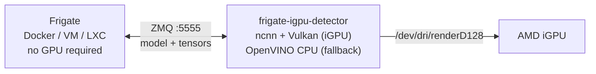

# Frigate iGPU Detector

[](https://github.com/abu9/frigate-igpu-detector/actions/workflows/ci.yml)
[](LICENSE)
[](pyproject.toml)

**English** | [简体中文](README.zh-CN.md)

Remote object detection for Frigate on AMD integrated GPUs. ncnn + Vulkan inside a Proxmox LXC —
no VM passthrough, no ROCm.

Frigate iGPU Detector is a ZMQ detector server for Frigate 0.18.x. It runs YOLO inference on an
AMD iGPU through ncnn and Vulkan (Mesa RADV), inside a Proxmox LXC or on bare metal, and falls
back to OpenVINO on the CPU if the GPU is unavailable.

On a Ryzen 7 4800H (Vega 7) with YOLOv9-m 320×320, the same workload drops from **3.1 CPU cores
to 0.02–0.07 cores** at the same ~47 ms latency.

## Why this project

Frigate supports AMD GPUs through ROCm, but that path is designed for discrete GPUs:

- ROCm does not officially support integrated GPUs; iGPUs require driver overrides such as
  `HSA_OVERRIDE_GFX_VERSION`.
- It requires `/dev/kfd` and `/dev/dri`, a multi-gigabyte runtime, and the `-rocm` Frigate image.
- On Proxmox this usually means passing a GPU into a virtual machine.

OpenVINO's GPU plugin is Intel-only, so an AMD iGPU falls back to CPU inference.

This project uses the Vulkan compute path instead:

- Only `/dev/dri/renderD128` is required. No `/dev/kfd`, no IOMMU/VFIO, no `card0`.
- It runs in an unprivileged LXC. The host only needs the in-tree `amdgpu` driver.
- No ROCm, CUDA, or proprietary runtime; Mesa RADV ships with the distribution.
- Frigate does not need GPU access at all and can run on a different host.

## Features

- **Frigate-compatible.** Implements the Frigate 0.18.x ZMQ detector protocol; no Frigate patch
  or fork is required.
- **Two backends.** `ncnn-vulkan` (GPU, fp16) and `openvino` (CPU).
- **Automatic fallback.** If the GPU is unavailable, the server logs the reason and continues on
  OpenVINO instead of failing.
- **One-time model conversion.** The ONNX file sent by Frigate is converted with pnnx once and
  cached by content hash under `models/ncnn/`.
- **Restart-safe.** The newest cached model is loaded at startup, because Frigate sends the model
  only during its own startup.
- **Operational tooling.** `fzd preflight` validates runtime dependencies before startup;
  `fzd doctor` validates the render node, group mapping, Vulkan device, ncnn, pnnx, and model
  cache; `fzd status` shows the live service, backend, model, GPU load, and optional inference
  probe; `fzd bench` reports p50/p95 latency and CPU per inference.

## Architecture



## Performance

YOLOv9-m 320×320 on a Ryzen 7 4800H (Vega 7), Frigate 0.18.2, Mesa 25.2 on Ubuntu 24.04,
live load of about 15 inferences/s:

| Backend | Latency p50 | Latency p95 | CPU at 15 inf/s | iGPU utilisation |
| --- | ---: | ---: | ---: | ---: |
| OpenVINO CPU, 6 threads | 54 ms | 57 ms | **3.1 cores** | — |
| ncnn + Vulkan, fp16 | 47 ms | 54–71 ms | **0.02–0.07 cores** | 70–80 % |

The gain is in CPU time rather than latency. OpenVINO spends roughly 200 ms of CPU per
inference; ncnn + Vulkan spends about 2.5 ms, and the remainder runs on the GPU. At this load,
three CPU cores remain available to Frigate, go2rtc, and other services on the host.

Detection quality is unchanged: on 12 real fisheye tiles both backends produced identical
detection counts, with per-box score differences ≤ 0.019 and IoU ≥ 0.973.

Reproduce the measurement on your own hardware:

```bash
fzd bench --model /path/to/yolov9-m-320.onnx --backend ncnn-vulkan --runs 100
```

Throughput is bounded by the serial ZMQ request loop, approximately `1 / latency` (about 20
inferences/s here). More cameras or a larger model require multiple instances or a smaller model.

## Requirements

**Host**

- Linux with the in-tree `amdgpu` driver and a working Vulkan device.
- No IOMMU, VFIO, or GPU passthrough configuration.

**Container**

- Ubuntu 24.04 or Debian 12, unprivileged.
- 2 vCPU, 1 GB RAM, 2–4 GB disk (see [container sizing](docs/proxmox-lxc.md#container-sizing)).
- `/dev/dri/renderD128` accessible by the service user.

```bash
apt install -y python3 python3-venv git ca-certificates curl \
  mesa-vulkan-drivers libvulkan1 vulkan-tools
```

**Runtime**

- The pnnx release binary (28 MB download, 85 MB installed).
- A YOLO ONNX model exported for Frigate (`yolo-generic`, NCHW, RGB, float).

## Installation

### 1. Install pnnx

```bash
PNNX_VERSION=20261020   # check https://github.com/pnnx/pnnx/releases
curl -sSL -o /tmp/pnnx.zip \
  "https://github.com/pnnx/pnnx/releases/download/${PNNX_VERSION}/pnnx-${PNNX_VERSION}-linux.zip"
python3 -m zipfile -e /tmp/pnnx.zip /tmp/pnnx-bin
install -m 0755 "/tmp/pnnx-bin/pnnx-${PNNX_VERSION}-linux/pnnx" /usr/local/bin/pnnx
pnnx 2>&1 | head -1
```

Do not install pnnx from PyPI unless PyTorch is already present: the wheel's console script
imports `torch`, while the bundled ELF binary does not need it. If the wheel is installed, this
project will locate the bundled binary automatically.

### 2. Create the service account

```bash
useradd --system --user-group \
  --home-dir /var/lib/frigate-detector \
  --shell /usr/sbin/nologin frigate-detector
usermod -aG render frigate-detector

install -d -o frigate-detector -g frigate-detector -m 0750 /var/lib/frigate-detector
```

### 3. Install the project

```bash
git clone https://github.com/abu9/frigate-igpu-detector.git /opt/frigate-igpu-detector
cd /opt/frigate-igpu-detector
python3 -m venv venv
venv/bin/pip install '.[ncnn,openvino]'

# Make the CLI available after SSH login:
ln -sfn /opt/frigate-igpu-detector/venv/bin/fzd /usr/local/bin/fzd
fzd --version
```

`openvino` is optional and only needed for the CPU fallback. Without it, the server still runs
on `ncnn-vulkan`.

If you intentionally use system-wide `ncnn` and OpenVINO instead of the extras, create the
virtualenv with system packages and confirm the setting:

```bash
python3 -m venv --system-site-packages venv
grep '^include-system-site-packages' venv/pyvenv.cfg
# include-system-site-packages = true
venv/bin/pip install .
```

Do not run `python3 -m venv venv` again on an existing production virtualenv: it rewrites
`pyvenv.cfg` and resets `include-system-site-packages` to `false`. That makes the service lose
access to system `ncnn`/OpenVINO after the next restart.

### 4. Install the systemd unit

```bash
install -m 0644 contrib/frigate-igpu-detector.service /etc/systemd/system/
systemctl daemon-reload
systemctl enable --now frigate-igpu-detector
```

Review the unit before starting it; the defaults assume the user, paths, and venv created above.
`SupplementaryGroups=render` is required for render-node access, and
`RestrictAddressFamilies` must include `AF_NETLINK` for ZeroMQ address resolution.

### 5. Verify

```bash
fzd preflight
fzd doctor
fzd status
```

A healthy installation reports a real Vulkan device, not `llvmpipe`:

```text
[ OK ] render node: /dev/dri/renderD128
[ OK ] group membership: render
[ OK ] Vulkan devices: AMD Radeon Graphics (RADV RENOIR)
[ OK ] ncnn Vulkan: 2 device(s), default gpu 0
[ OK ] pnnx: /usr/local/bin/pnnx
```

### Updating a deployment

The service runs the package installed in the virtualenv, not the git working tree:

```bash
cd /opt/frigate-igpu-detector
git pull
venv/bin/pip install --force-reinstall --no-deps .
systemctl restart frigate-igpu-detector
```

## Command line

```bash
fzd preflight                 # dependency/config check used by systemd
fzd doctor                    # GPU, Vulkan, ncnn, pnnx and model-cache check
fzd status                    # running service, backend, model and GPU load
fzd status --json             # machine-readable status
fzd status --check            # exit 1 when the service is unhealthy
fzd status --probe            # status plus a real ZMQ inference probe
fzd probe --model MODEL       # standalone protocol/inference probe
fzd bench --model MODEL       # latency and CPU benchmark
```

Running `fzd` without a subcommand prints help; start the server explicitly with `fzd serve`.
`fzd status` reads the running unit's environment, so it is safe to run as root after SSH login.
`fzd bench` writes ncnn conversion files; run it as the service user to keep cache ownership
consistent.

## Monitoring

Set `FRIGATE_ZMQ_STATUS_BIND` to enable a read-only HTTP status endpoint:

```ini
Environment=FRIGATE_ZMQ_STATUS_BIND=0.0.0.0:9180
```

Then:

```bash
curl -s http://127.0.0.1:9180/status | python3 -m json.tool
# `/` returns the same JSON, for quick browser checks.
curl -s http://127.0.0.1:9180/ | python3 -m json.tool
```

The response contains backend/model state, live CPU/GPU/memory, and inference latency:

```json
{
  "version": "0.2.0",
  "backend": {"configured": "ncnn-vulkan", "active": "ncnn-vulkan", "fallback": false},
  "model": {"name": "yolov9-m-320.onnx", "loaded": true, "available": true},
  "live": {
    "cpu_percent": 2.2,
    "cpu_cores": 0.022,
    "gpu_busy_percent": 41,
    "cgroup_memory_bytes": 116000000,
    "resident_memory_bytes": 206000000
  },
  "inference": {
    "requests_total": 12345,
    "errors_total": 0,
    "rejected_total": 0,
    "last_ms": 44.1,
    "p50_ms": 43.9,
    "p95_ms": 71.2,
    "window": 300
  }
}
```

`cpu_percent` is process CPU usage where 100 means one full core. Inference latency is measured
around the model call (forward + post-processing), excluding ZMQ transport.

For Uptime Kuma, monitor `http://HOST:9180/status` with expected status 200 and the keyword
`"loaded":true` (or `"loaded":true` plus `"active":"ncnn-vulkan"`). For a status-code-only monitor,
use:

```text
http://HOST:9180/status?require_model=1
```

which returns 503 while no model is loaded.

The endpoint has no authentication. Bind it to localhost, or to a trusted LAN address with a
firewall rule. It exposes no model contents or secrets.

## Proxmox LXC

Proxmox VE 8.2 and later provides device passthrough for containers. Run the following on the
host. The examples use container ID `101`; replace it with your container's ID. Use the GID of
the `render` group **inside the container**:

```bash
pct exec 101 -- getent group render        # render:x:993:  -> use 993
pct set 101 -dev0 /dev/dri/renderD128,gid=993,mode=0660
pct reboot 101
pct exec 101 -- ls -l /dev/dri/            # crw-rw---- root render
```

Older Proxmox versions and manual configurations require the raw `lxc.*` keys and, for
unprivileged containers, an `lxc.idmap` entry. See
[docs/proxmox-lxc.md](docs/proxmox-lxc.md) for the complete procedure and the security notes.

## Frigate configuration

```yaml
detectors:
  igpu:
    type: zmq
    endpoint: tcp://192.168.1.50:5555   # host running this sidecar
    request_timeout_ms: 1000
    linger_ms: 0

model:
  path: /config/yolov9-m-320.onnx       # supplied by the user
  width: 320
  height: 320
  input_tensor: nchw
  input_pixel_format: rgb
  input_dtype: float
  model_type: yolo-generic
```

Frigate does not need GPU access; the sidecar does not need camera streams.

## Configuration reference

All settings are environment variables, read once at process start.

| Variable | Default | Description |
| --- | --- | --- |
| `FRIGATE_ZMQ_BACKEND` | `openvino` | `ncnn-vulkan` or `openvino` |
| `FRIGATE_ZMQ_BIND` | `tcp://0.0.0.0:5555` | ZMQ REP endpoint |
| `FRIGATE_ZMQ_MODEL_DIR` | `/var/lib/frigate-detector/models` | ONNX uploads and ncnn cache (`ncnn/`) |
| `FRIGATE_ZMQ_NCNN_THREADS` | `1` | ncnn CPU worker threads; 1 is fastest for GPU inference |
| `FRIGATE_ZMQ_CPU_THREADS` | `4` | OpenVINO CPU threads (6 recommended on 8-core Zen 2) |
| `FRIGATE_ZMQ_GPU_INDEX` | `-1` | Vulkan device index; `-1` uses the ncnn default |
| `FRIGATE_ZMQ_PNNX` | auto-detected | Path to the pnnx executable |
| `FRIGATE_ZMQ_MAX_MODEL_MB` | `512` | Maximum accepted ONNX upload |
| `FRIGATE_ZMQ_STATUS_BIND` | empty (disabled) | `host:port` for the read-only `/status` endpoint, e.g. `127.0.0.1:9180` |
| `FRIGATE_ZMQ_LOG_LEVEL` | `INFO` | Python logging level |

`fzd doctor` reads the systemd unit's effective environment first (the unit name can be
overridden with `FRIGATE_ZMQ_UNIT`, default `frigate-igpu-detector.service`) and falls back to
the invoking shell. This way it reports `ncnn-vulkan` even when run without the unit's
environment variables.

## Changing configuration

There is no live reload. Change the value, then restart the service.

### systemd drop-in

A drop-in survives package upgrades:

```bash
systemctl edit frigate-igpu-detector
```

```ini
[Service]
Environment=FRIGATE_ZMQ_BACKEND=openvino
Environment=FRIGATE_ZMQ_CPU_THREADS=8
```

```bash
systemctl daemon-reload
systemctl restart frigate-igpu-detector
systemctl show -p Environment frigate-igpu-detector   # effective values
journalctl -u frigate-igpu-detector -n 20 -o cat      # active backend
```

### Environment file

Alternatively, point the unit at a file with `EnvironmentFile=-/etc/frigate-igpu-detector.env`
and define the variables there.

### Common changes

| Goal | Change | Notes |
| --- | --- | --- |
| Switch to CPU | `FRIGATE_ZMQ_BACKEND=openvino` | requires the `openvino` extra |
| Restrict the listener | `FRIGATE_ZMQ_BIND=tcp://192.168.1.50:5555` | no authentication; firewall the port |
| Move model storage | `FRIGATE_ZMQ_MODEL_DIR=/new/path` | copy the whole directory, including `ncnn/` |
| Select another GPU | `FRIGATE_ZMQ_GPU_INDEX=1` | `fzd doctor` lists visible devices |
| Reduce CPU spin | `FRIGATE_ZMQ_NCNN_THREADS=1` | already the default |
| Increase OpenVINO threads | `FRIGATE_ZMQ_CPU_THREADS=6` | CPU backend only |
| Verbose logs | `FRIGATE_ZMQ_LOG_LEVEL=DEBUG` | |

### Model changes

Update `model.path` (and width/height) in Frigate and restart Frigate. Frigate sends the new
model bytes; the sidecar converts them once and removes the previous cache entry for that model
name. A sidecar restart is not required, but is safe: the newest cached model is loaded on
startup.

## How it works

- **Model transport.** Frigate sends the ONNX file over ZMQ at startup. The server stores it in
  `FRIGATE_ZMQ_MODEL_DIR` and converts it to ncnn with pnnx, keyed by the file's SHA-256.
- **Inference.** Requests are NCHW float32 tensors. The ncnn backend uses fp16 Vulkan compute;
  the CPU backend uses OpenVINO with one in-flight request.
- **Fallback.** If Vulkan initialisation fails, the server starts on OpenVINO. If a specific
  model fails to convert, that model is retried on OpenVINO.
- **Startup guard.** A warmup longer than 5 seconds indicates the llvmpipe software rasteriser;
  the server refuses the Vulkan backend and falls back instead of running at ~1 s per inference.

See [docs/backends.md](docs/backends.md) for details.

## Limitations

- One request at a time; the ZMQ detector protocol does not batch.
- The iGPU is shared with the host and other containers. Transcoding or desktop workloads
  increase p95 latency.
- AMD's Vulkan stack has no usable INT8 acceleration, so quantisation gains are limited.
- pnnx cannot convert every ONNX graph. Unsupported operators require a different export or the
  OpenVINO backend.
- ROCm is likely faster on discrete AMD GPUs; this project targets integrated GPUs and LXC
  deployments.
- The server holds one model at a time, matching Frigate's ZMQ detector semantics.

## Troubleshooting

| Symptom | Cause |
| --- | --- |
| `fzd doctor` shows only `llvmpipe` | render node not accessible: wrong GID, missing `render` group, or missing `mesa-vulkan-drivers` |
| `ModuleNotFoundError: No module named 'ncnn'` after a restart | the venv no longer inherits system site packages; check `include-system-site-packages` in `venv/pyvenv.cfg` |
| Unit fails with `no usable inference backend` | neither ncnn nor OpenVINO is importable; run `fzd preflight` for the exact cause |
| Log says `OpenVINO CPU` while `ncnn-vulkan` is configured | Vulkan initialisation failed; the preceding log line has the reason |
| Service aborts with `Address family not supported` | `RestrictAddressFamilies` is missing `AF_NETLINK` |
| Detections are all zero after a restart | the model directory is not persistent, so autoload found no model |
| `pnnx conversion failed` | unsupported operator; use OpenVINO or a simpler export |

Additional detail: [docs/troubleshooting.md](docs/troubleshooting.md).

## Security

The ZMQ endpoint has no authentication and accepts model uploads from connected clients. Run it
on a trusted network, bind to a LAN address, and do not expose port 5555 to the internet. Passing
a render node into a container exposes the DRM ioctl surface; keep the container unprivileged.
See [SECURITY.md](SECURITY.md).

## Development

```bash
pip install -e '.[dev,openvino,ncnn]'
ruff check src tests
pytest -q
```

Tests do not require a GPU.

## Credits

YOLO post-processing follows Frigate's `frigate/util/model.py`
(MIT License, Copyright (c) Frigate, Inc.). This project is unofficial and not affiliated with
the Frigate project.

## License

MIT — see [LICENSE](LICENSE).
