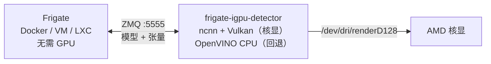

# Frigate iGPU Detector

[](https://github.com/abu9/frigate-igpu-detector/actions/workflows/ci.yml)
[](LICENSE)
[](pyproject.toml)

[English](README.md) | **简体中文**

在 AMD 核显上运行 Frigate 目标检测。ncnn + Vulkan 部署于 Proxmox LXC，无需 VM 直通，也不需要 ROCm。

Frigate iGPU Detector 是面向 Frigate 0.18.x 的 ZMQ 检测服务。它通过 ncnn + Vulkan（Mesa
RADV）在 AMD 核显上执行 YOLO 推理，可部署于 Proxmox LXC 或物理机；GPU 不可用时自动回退到
OpenVINO CPU。

以 Ryzen 7 4800H（Vega 7）和 YOLOv9-m 320×320 实测，相同负载下 CPU 占用从 **3.1 核降至
0.02–0.07 核**，延迟保持在约 47 ms。

## 背景

Frigate 通过 ROCm 支持 AMD GPU，但该路径面向独立显卡：

- ROCm 官方不支持核显，iGPU 需要 `HSA_OVERRIDE_GFX_VERSION` 一类驱动覆盖；
- 需要 `/dev/kfd` 与 `/dev/dri`、数 GB 运行时，以及 `-rocm` 版 Frigate 镜像；
- 在 Proxmox 上通常需要把 GPU 直通给虚拟机。

OpenVINO 的 GPU 插件仅支持 Intel，AMD 核显只能退回 CPU 推理。

本项目采用 Vulkan 计算路径：

- 仅需 `/dev/dri/renderD128`，不需要 `/dev/kfd`、IOMMU/VFIO 或 `card0`；
- 可运行在非特权 LXC 中，宿主机只需内核自带的 `amdgpu` 驱动；
- 不依赖 ROCm、CUDA 或专有运行时，Mesa RADV 随发行版提供；
- Frigate 本身无需 GPU，可与本服务分开部署。

## 主要特性

- **兼容 Frigate。** 实现 Frigate 0.18.x 的 ZMQ detector 协议，无需修改或重新编译 Frigate。
- **两种后端。** `ncnn-vulkan`（GPU，fp16）与 `openvino`（CPU）。
- **自动回退。** GPU 不可用时记录原因并切换 OpenVINO，不会直接失败。
- **模型只转换一次。** Frigate 传来的 ONNX 由 pnnx 转换，按内容哈希缓存在 `models/ncnn/`。
- **重启安全。** 启动时加载最新的缓存模型；Frigate 仅在自己启动时发送一次模型。
- **运维工具。** `fzd preflight` 在启动前检查运行时依赖；`fzd doctor` 检查 render 节点、组映射、
  Vulkan 设备、ncnn、pnnx 与模型缓存；`fzd status` 查看服务、后端、模型、GPU 负载，并可选执行
  端到端推理探测；`fzd bench` 输出 p50/p95 延迟和单次推理 CPU。

## 架构



## 性能

YOLOv9-m 320×320，Ryzen 7 4800H（Vega 7），Frigate 0.18.2，Ubuntu 24.04 + Mesa 25.2，
实况负载约 15 次推理/秒：

| 后端 | p50 延迟 | p95 延迟 | 15 次/秒时 CPU | 核显占用 |
| --- | ---: | ---: | ---: | ---: |
| OpenVINO CPU，6 线程 | 54 ms | 57 ms | **3.1 核** | — |
| ncnn + Vulkan，fp16 | 47 ms | 54–71 ms | **0.02–0.07 核** | 70–80 % |

收益主要体现在 CPU，而非延迟。OpenVINO 单次推理约消耗 200 ms CPU，ncnn + Vulkan 约
2.5 ms，其余工作在 GPU 上完成。按该负载计算，约 3 个 CPU 核可以留给 Frigate、go2rtc
和宿主机上的其他服务。

检测质量不变：在 12 个真实鱼眼画面上，两种后端的检测数量完全一致，同一检测框的分数差
≤ 0.019，IoU ≥ 0.973。

可在自有硬件上复现：

```bash
fzd bench --model /path/to/yolov9-m-320.onnx --backend ncnn-vulkan --runs 100
```

吞吐受 ZMQ 串行请求循环限制，约为 `1 / 延迟`（本机约 20 次/秒）。如需支持更多摄像头或更大
的模型，应部署多个实例或改用更小的模型。

## 环境要求

**宿主机**

- Linux，加载内核自带的 `amdgpu` 驱动，具备可用的 Vulkan 设备。
- 无需配置 IOMMU、VFIO 或 GPU 直通。

**容器**

- Ubuntu 24.04 或 Debian 12，非特权容器。
- 2 vCPU、1 GB 内存、2–4 GB 磁盘（参见[容器规格](docs/proxmox-lxc.md#container-sizing)）。
- 服务用户可访问 `/dev/dri/renderD128`。

```bash
apt install -y python3 python3-venv git ca-certificates curl \
  mesa-vulkan-drivers libvulkan1 vulkan-tools
```

**运行时**

- pnnx 官方发布的二进制（下载 28 MB，安装后 85 MB）。
- 按 Frigate 要求导出的 YOLO ONNX 模型（`yolo-generic`、NCHW、RGB、float）。

## 安装

### 1. 安装 pnnx

```bash
PNNX_VERSION=20261020   # 最新版本见 https://github.com/pnnx/pnnx/releases
curl -sSL -o /tmp/pnnx.zip \
  "https://github.com/pnnx/pnnx/releases/download/${PNNX_VERSION}/pnnx-${PNNX_VERSION}-linux.zip"
python3 -m zipfile -e /tmp/pnnx.zip /tmp/pnnx-bin
install -m 0755 "/tmp/pnnx-bin/pnnx-${PNNX_VERSION}-linux/pnnx" /usr/local/bin/pnnx
pnnx 2>&1 | head -1
```

不建议从 PyPI 安装 pnnx，除非环境里已有 PyTorch：wheel 的命令行脚本会 `import torch`，
而其中捆绑的 ELF 二进制不需要。如果已经装了 wheel，本项目会自动定位该二进制。

### 2. 创建服务账号

```bash
useradd --system --user-group \
  --home-dir /var/lib/frigate-detector \
  --shell /usr/sbin/nologin frigate-detector
usermod -aG render frigate-detector

install -d -o frigate-detector -g frigate-detector -m 0750 /var/lib/frigate-detector
```

### 3. 安装项目

```bash
git clone https://github.com/abu9/frigate-igpu-detector.git /opt/frigate-igpu-detector
cd /opt/frigate-igpu-detector
python3 -m venv venv
venv/bin/pip install '.[ncnn,openvino]'

# SSH 登录后直接使用 fzd：
ln -sfn /opt/frigate-igpu-detector/venv/bin/fzd /usr/local/bin/fzd
fzd --version
```

`openvino` 为可选依赖，仅用于 CPU 回退。未安装时服务仍可在 `ncnn-vulkan` 上运行。

如果 `ncnn` 和 OpenVINO 使用系统包，而不是安装到 venv，则需要用系统站点包创建虚拟环境，
并确认开关为 `true`：

```bash
python3 -m venv --system-site-packages venv
grep '^include-system-site-packages' venv/pyvenv.cfg
# include-system-site-packages = true
venv/bin/pip install .
```

不要在已投入使用的 venv 上再次执行 `python3 -m venv venv`。该命令会重写 `pyvenv.cfg`，把
`include-system-site-packages` 重置为 `false`，导致服务下次重启后看不到系统的
`ncnn`/OpenVINO。

### 4. 安装 systemd 单元

```bash
install -m 0644 contrib/frigate-igpu-detector.service /etc/systemd/system/
systemctl daemon-reload
systemctl enable --now frigate-igpu-detector
```

启动前请核对单元中的用户、路径和 venv，默认值与上述步骤一致。以下两项必须保留：

- `SupplementaryGroups=render`：允许服务访问 render 节点；
- `RestrictAddressFamilies=AF_UNIX AF_INET AF_INET6 AF_NETLINK`：ZeroMQ 解析地址所需。

### 5. 验证

```bash
fzd preflight
fzd doctor
fzd status
```

正常输出应显示真实的 Vulkan 设备，而不是 `llvmpipe`：

```text
[ OK ] render node: /dev/dri/renderD128
[ OK ] group membership: render
[ OK ] Vulkan devices: AMD Radeon Graphics (RADV RENOIR)
[ OK ] ncnn Vulkan: 2 device(s), default gpu 0
[ OK ] pnnx: /usr/local/bin/pnnx
```

### 更新部署

服务运行的是虚拟环境中安装的副本，不是 git 工作区：

```bash
cd /opt/frigate-igpu-detector
git pull
venv/bin/pip install --force-reinstall --no-deps .
systemctl restart frigate-igpu-detector
```

## 命令行

```bash
fzd preflight                 # systemd 启动前的依赖和配置检查
fzd doctor                    # GPU、Vulkan、ncnn、pnnx 与模型缓存检查
fzd status                    # 服务、后端、模型与 GPU 负载
fzd status --json             # 机器可读状态
fzd status --check            # 不健康时返回 1
fzd status --probe            # 状态加真实 ZMQ 推理探测
fzd probe --model MODEL       # 独立协议/推理探测
fzd bench --model MODEL       # 延迟与 CPU 基准测试
```

不带子命令运行 `fzd` 只显示帮助；启动服务必须显式执行 `fzd serve`。`fzd status` 会读取正在
运行单元的环境，因此 SSH 登录后直接用 root 执行即可。`fzd bench` 会写入 ncnn 转换缓存，建议
用服务用户执行，避免缓存文件属主变成 root。

## Proxmox LXC 配置

Proxmox VE 8.2 及更高版本提供容器设备透传。在宿主机执行以下命令；示例使用容器 ID
`101`，请替换为实际 ID。`gid` 填写**容器内** `render` 组的 GID：

```bash
pct exec 101 -- getent group render        # render:x:993:  -> 使用 993
pct set 101 -dev0 /dev/dri/renderD128,gid=993,mode=0660
pct reboot 101
pct exec 101 -- ls -l /dev/dri/            # crw-rw---- root render
```

旧版 Proxmox 或手写配置需要使用 `lxc.*` 参数；非特权容器还需配置 `lxc.idmap`。完整步骤和
安全注意事项见 [docs/proxmox-lxc.md](docs/proxmox-lxc.md)。

## Frigate 配置

```yaml
detectors:
  igpu:
    type: zmq
    endpoint: tcp://192.168.1.50:5555   # 运行本服务的机器
    request_timeout_ms: 1000
    linger_ms: 0

model:
  path: /config/yolov9-m-320.onnx       # 模型由用户提供
  width: 320
  height: 320
  input_tensor: nchw
  input_pixel_format: rgb
  input_dtype: float
  model_type: yolo-generic
```

Frigate 无需 GPU 访问权限，本服务也不需要摄像头视频流。

## 配置项

所有配置均为环境变量，在进程启动时读取一次。

| 变量 | 默认值 | 说明 |
| --- | --- | --- |
| `FRIGATE_ZMQ_BACKEND` | `openvino` | `ncnn-vulkan` 或 `openvino` |
| `FRIGATE_ZMQ_BIND` | `tcp://0.0.0.0:5555` | ZMQ REP 监听地址 |
| `FRIGATE_ZMQ_MODEL_DIR` | `/var/lib/frigate-detector/models` | ONNX 上传与 ncnn 缓存（`ncnn/`） |
| `FRIGATE_ZMQ_NCNN_THREADS` | `1` | ncnn CPU 工作线程数；GPU 推理时 1 最快 |
| `FRIGATE_ZMQ_CPU_THREADS` | `4` | OpenVINO CPU 线程数（8 核 Zen 2 建议 6） |
| `FRIGATE_ZMQ_GPU_INDEX` | `-1` | Vulkan 设备序号；`-1` 使用 ncnn 默认值 |
| `FRIGATE_ZMQ_PNNX` | 自动检测 | pnnx 可执行文件路径 |
| `FRIGATE_ZMQ_MAX_MODEL_MB` | `512` | 允许接收的 ONNX 大小上限 |
| `FRIGATE_ZMQ_LOG_LEVEL` | `INFO` | Python 日志级别 |

`fzd doctor` 会优先读取 systemd 单元的实际运行环境（单元名可用 `FRIGATE_ZMQ_UNIT` 覆盖，
默认 `frigate-igpu-detector.service`），读取失败时才回退到当前 shell。因此在没有导出环境变量
的情况下，它也能显示服务实际使用的 `ncnn-vulkan`。

## 修改配置

配置不支持热重载：修改后需重启服务。

### systemd drop-in

使用 drop-in 覆盖配置，升级软件包时不会被覆盖：

```bash
systemctl edit frigate-igpu-detector
```

```ini
[Service]
Environment=FRIGATE_ZMQ_BACKEND=openvino
Environment=FRIGATE_ZMQ_CPU_THREADS=8
```

```bash
systemctl daemon-reload
systemctl restart frigate-igpu-detector
systemctl show -p Environment frigate-igpu-detector   # 实际生效的值
journalctl -u frigate-igpu-detector -n 20 -o cat      # 当前后端
```

### 环境变量文件

也可以通过 `EnvironmentFile=-/etc/frigate-igpu-detector.env` 引用单独的环境变量文件。

### 常见修改

| 目标 | 修改 | 说明 |
| --- | --- | --- |
| 切换到 CPU | `FRIGATE_ZMQ_BACKEND=openvino` | 需要安装 `openvino` 可选依赖 |
| 限制监听地址 | `FRIGATE_ZMQ_BIND=tcp://192.168.1.50:5555` | 端口无认证，需配合防火墙 |
| 迁移模型目录 | `FRIGATE_ZMQ_MODEL_DIR=/new/path` | 整个目录一起复制（含 `ncnn/`） |
| 选择另一块 GPU | `FRIGATE_ZMQ_GPU_INDEX=1` | `fzd doctor` 会列出可见设备 |
| 降低 ncnn CPU 空转 | `FRIGATE_ZMQ_NCNN_THREADS=1` | 默认值即为 1 |
| 增加 OpenVINO 线程 | `FRIGATE_ZMQ_CPU_THREADS=6` | 仅影响 CPU 后端 |
| 输出调试日志 | `FRIGATE_ZMQ_LOG_LEVEL=DEBUG` | |

### 更换模型

修改 Frigate 的 `model.path`（及宽高）并重启 Frigate。Frigate 会重新发送模型字节，本服务
转换一次并清理同名模型的旧缓存。无需重启本服务；重启同样安全，启动时会加载最新缓存。

## 工作原理

- **模型传输。** Frigate 启动时通过 ZMQ 发送 ONNX 文件。服务将其保存到
  `FRIGATE_ZMQ_MODEL_DIR`，由 pnnx 转换为 ncnn，并以文件 SHA-256 作为缓存键。
- **推理。** 请求为 NCHW float32 张量。ncnn 后端使用 fp16 Vulkan 计算；CPU 后端使用
  OpenVINO，同一时间仅处理一个请求。
- **回退。** Vulkan 初始化失败时，服务以 OpenVINO 启动；某个模型转换失败时，该模型改用
  OpenVINO 加载。
- **启动保护。** 预热超过 5 秒即判定为 llvmpipe 软件渲染，服务会拒绝 Vulkan 后端并回退，
  而不是以约 1 秒/次的速率运行。

更多细节见 [docs/backends.md](docs/backends.md)。

## 限制

- 一次只处理一个请求；ZMQ detector 协议不支持批处理。
- 核显与宿主机及其他容器共享，转码或桌面负载会抬高 p95 延迟。
- AMD 的 Vulkan 栈没有可用的 INT8 加速，量化收益有限。
- pnnx 无法转换所有 ONNX 图；遇到不支持的算子时需更换导出方式或使用 OpenVINO 后端。
- 在 AMD 独立显卡上 ROCm 可能更快；本项目面向核显和 LXC 部署。
- 服务一次只加载一个模型，与 Frigate ZMQ detector 的语义一致。

## 故障排查

| 现象 | 原因 |
| --- | --- |
| `fzd doctor` 只能看到 `llvmpipe` | render 节点不可访问：GID 错误、用户不在 `render` 组，或未安装 `mesa-vulkan-drivers` |
| 重启后报 `ModuleNotFoundError: No module named 'ncnn'` | venv 不再继承系统站点包；检查 `venv/pyvenv.cfg` 的 `include-system-site-packages` |
| 服务失败并报 `no usable inference backend` | ncnn 和 OpenVINO 都不可导入；运行 `fzd preflight` 查看具体原因 |
| 配置为 `ncnn-vulkan`，日志却显示 `OpenVINO CPU` | Vulkan 初始化失败，上一行日志包含原因 |
| 服务报 `Address family not supported` 后中止 | `RestrictAddressFamilies` 缺少 `AF_NETLINK` |
| 重启后检测结果全为零 | 模型目录未持久化，启动时没有可加载的缓存模型 |
| `pnnx conversion failed` | 存在不支持的算子；改用 OpenVINO 或更简单的导出 |

更多内容见 [docs/troubleshooting.md](docs/troubleshooting.md)。

## 安全

ZMQ 端口没有认证，并接受客户端上传模型。请仅在可信网络中运行，绑定内网地址，不要把
5555 端口暴露到公网。将 render 节点透传给容器会暴露 DRM ioctl 接口，请保持容器为非特权。
详见 [SECURITY.md](SECURITY.md)。

## 开发

```bash
pip install -e '.[dev,openvino,ncnn]'
ruff check src tests
pytest -q
```

测试不需要 GPU。

## 致谢

YOLO 后处理逻辑对齐 Frigate 的 `frigate/util/model.py`（MIT License，Copyright (c) Frigate, Inc.）。
本项目为非官方项目，与 Frigate 官方无隶属关系。

## 许可证

MIT，见 [LICENSE](LICENSE)。
